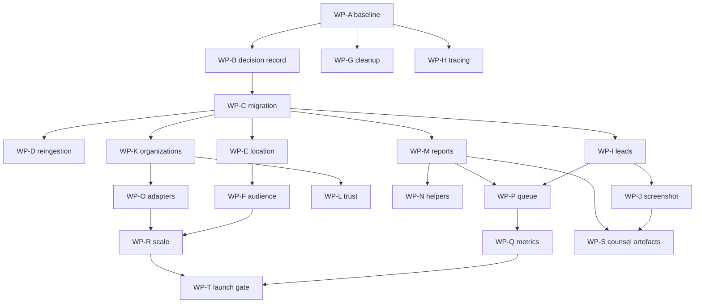

# OppScout implementation plan

This plan is based only on verified repository facts and explicitly marked assumptions. It changes no product file during this review. Every implementation change must be behind a false-by-default flag, dry-run by default, and mirrored in Prisma, Supabase, and memory adapters.

## Principles and gates

1. Preserve deterministic offline matching and existing user data.
2. Never approve a listing automatically; automation may classify, hold, or queue.
3. Use private evidence storage, reviewer ID, reviewer note, and an append-only change log.
4. Validate URLs against an allowlist and private-network protections before server-side fetches.
5. Every migration enables RLS and adds its tables to `scripts/check-rls.ts`.
6. No live network access in CI; use recorded fixtures.
7. Vercel Hobby and Supabase Free are capacity constraints, not assumptions: measure duration, rows, storage, and request volume before enablement.

## Work packages

Each package includes objective/acceptance, files, schema/RLS, flags, tests, scripts, dependencies, rollback, effort/confidence, automation, and free-tier impact.

### WP-A — Re-run catalogue audit (S1-S13)

- **Objective/acceptance:** reproduce snapshot and live counts; every count has SQL, timestamp, and offending rows; report exits non-zero on mismatch.
- **Files:** create `scripts/review/audit-live-catalog.ts`, `docs/review/evidence/live-catalog.txt`; update `docs/review/00-verification-report.md`.
- **Schema/RLS:** read-only; verify columns against `prisma/schema.prisma`; no migration.
- **Flags:** none.
- **Tests:** unit fixtures for state/category/source aggregation; contract test for live query shape; no live CI test.
- **Scripts:** dry-run is the only default; `--apply` is forbidden and rejected; output goes to `docs/review/evidence/`.
- **Dependencies:** read-only database URL and the plan’s section 2.3 SQL.
- **Risk/rollback:** query errors stop the script; delete only the generated evidence file.
- **Effort:** S, 3–5 hours, high confidence.
- **Automation:** AGENT+REVIEW; owner supplies access.
- **Free-tier:** SELECT-only and bounded result sets; no writes or storage growth.

### WP-B — Record table-freeze decision (F5)

- **Objective/acceptance:** add a dated deviation entry listing all existing models and rationale for each new model.
- **Files:** `docs/deviations.md`, `docs/review/evidence/model-inventory.txt`.
- **Schema/RLS:** no schema change; inventory is generated from Prisma.
- **Flags:** none.
- **Tests:** script asserts inventory equals schema models.
- **Scripts:** `scripts/review/verify-structure.ts`, dry-run only.
- **Dependencies:** WP-A and owner decision D1.
- **Risk/rollback:** revert the documentation entry only.
- **Effort:** S, 2–3 hours, high confidence.
- **Automation:** AGENT.
- **Free-tier:** none.

### WP-C — Provenance and review migration (F5, F9, F10)

- **Objective/acceptance:** add the four approved domain tables/columns only after the owner selects exact entities; all adapters support create/read/update and RLS passes.
- **Files:** `prisma/schema.prisma`, Prisma migration, `supabase/migrations/`, `src/lib/repository/{types,prisma,supabase,memory}.ts`, `scripts/check-rls.ts`.
- **Schema/RLS:** define `Organization` verification/trusted-poster fields, `Opportunity` provenance/audience fields, `ListingReport`, and lead/review entities only after a decision record; indexes cover status, organization, fingerprint, and deadlines; server-only policies follow the existing server repository migration.
- **Flags:** `audienceGate`, `leadIntake`, `trustV2`, all false.
- **Tests:** Prisma validate, migration SQL review, memory contract tests, Supabase contract fixtures, RLS inventory test.
- **Scripts:** dry-run migration audit; `--apply` only through normal migration tooling with human approval; change log in `docs/review/evidence/`.
- **Dependencies:** WP-B, D2, D5, D6, counsel for retention fields.
- **Risk/rollback:** deploy additive nullable columns/tables; rollback by disabling flags and forward migration, never destructive down migration.
- **Effort:** L, 24–40 hours, medium confidence.
- **Automation:** AGENT+REVIEW.
- **Free-tier:** indexes and row growth must be measured; private evidence storage is quota-sensitive.

### WP-D — Preserve verified status on re-ingestion (F11)

- **Objective/acceptance:** incoming content never lowers verified status; four explicit combinations cover authority, changed content, suspicious signals, and source freshness.
- **Files:** `src/services/ingestion/manual/index.ts`, deduplication helpers, adapter tests.
- **Schema/RLS:** add immutable review decision fields if needed; index fingerprint and canonical URL.
- **Flags:** `trustV2=false` until tests pass.
- **Tests:** memory rows 14/15; verified duplicate with lower authority; verified duplicate with suspicious text; changed description; stale source.
- **Scripts:** `scripts/review/reproduce-f11.ts` dry-run fixture; no apply mode.
- **Dependencies:** WP-C for fingerprint/review fields.
- **Risk/rollback:** retain old behavior only behind disabled flag; disable new path if any status downgrade appears.
- **Effort:** M, 8–12 hours, high confidence.
- **Automation:** AGENT.
- **Free-tier:** no extra requests; bounded duplicate query.

### WP-E — Resolve location before hard gates (F8)

- **Objective/acceptance:** Gulu matches Uganda/East Africa rules only when the rule permits the resolved parent; town-specific rules remain strict.
- **Files:** `src/services/matching/rule-based/hard-gates.ts`, shared location resolver, `tests/unit/matching.test.ts`.
- **Schema/RLS:** no table required; optionally version location taxonomy in a static fixture.
- **Flags:** `locationGateV2=false`.
- **Tests:** row 13, Gulu/Kampala/Uganda, Soroti, unknown place, multi-place value, exact town rule.
- **Scripts:** `scripts/review/reproduce-f8.ts`.
- **Dependencies:** WP-C only if audience metadata shares resolver.
- **Risk/rollback:** keep old equality path behind flag; disable on false-positive eligibility.
- **Effort:** M, 8–14 hours, medium confidence.
- **Automation:** AGENT.
- **Free-tier:** CPU-only.

### WP-F — Audience gate (L1, L2)

- **Objective/acceptance:** shadow diff identifies every hidden/current row; fail-closed gate and USSD use the same pure predicate; badges explain listing audience without inferring nationality.
- **Files:** create `src/services/matching/audience.ts`; feed route, USSD route, badge component, feature flag.
- **Schema/RLS:** add audience enum/rules to Opportunity with index on audience/status.
- **Flags:** `audienceGate=false`, `audienceShadow=true`; enable gate only after diff sign-off.
- **Tests:** Appendix B rows 1–12, 13–16 classification; web/USSD parity; missing rule fails closed.
- **Scripts:** `scripts/review/audience-diff.ts` dry-run CSV; apply mode rejected.
- **Dependencies:** WP-C, D2, WP-E, live baseline WP-A.
- **Risk/rollback:** disable gate; preserve shadow logs; never delete existing records.
- **Effort:** L, 24–36 hours, medium confidence.
- **Automation:** AGENT+REVIEW.
- **Free-tier:** feed filtering should be indexed; shadow logs must be sampled and retained briefly.

### WP-G — Catalogue clean-up (S4, S10, S13)

- **Objective/acceptance:** close stale dates, classify audience, and produce human-confirmation CSV; no automated approval.
- **Files:** create `scripts/review/clean-catalog.ts`, `classify-audience.ts`; evidence/change-log files.
- **Schema/RLS:** use existing status/deadline fields; store date-only deadlines at end of day in East Africa Time (`Africa/Nairobi`) and display the date; migration/backfill is human-reviewed.
- **Flags:** `catalogCleanup=false`.
- **Tests:** fixture rows for closed, closing soon, null deadline, date-only deadline at end of day EAT, and multi-country locations.
- **Scripts:** dry-run default; `--apply` requires explicit owner approval and writes a change log.
- **Dependencies:** WP-A, WP-F, D4.
- **Risk/rollback:** apply only from reviewed CSV; revert by generated inverse change log.
- **Effort:** M, 12–20 hours, high confidence.
- **Automation:** AGENT+REVIEW.
- **Free-tier:** one bounded batch avoids function timeout.

### WP-H — Trace pending Uganda records (S7)

- **Objective/acceptance:** generate a worksheet for 21 pending-active rows with stored organization, official links, candidate URL, evidence, and decision columns without fetching aggregators.
- **Files:** `scripts/review/trace-pending-uganda.ts`, `docs/review/evidence/pending-uganda.csv`.
- **Schema/RLS:** read-only.
- **Flags:** none.
- **Tests:** fixture row mapping and no-network assertion.
- **Scripts:** dry-run only; no apply.
- **Dependencies:** WP-A and owner reviewers.
- **Risk/rollback:** worksheet can be regenerated; no source rows change.
- **Effort:** M, 10–16 hours, high confidence.
- **Automation:** AGENT+REVIEW.
- **Free-tier:** no network and no database writes.

### WP-I — Lead intake (F10)

- **Objective/acceptance:** authenticated `POST /api/v1/leads` validates, fingerprints, deduplicates, rate-limits, queues triage within 48 hours, and expires after 7 days.
- **Files:** route, validation, lead service, all repository adapters, worker, admin quick-add form.
- **Schema/RLS:** Lead, evidence, lifecycle, unique fingerprint, per-user daily index, server-only RLS.
- **Flags:** `leadIntake=false`.
- **Tests:** unit validation, contract route, duplicate SQL/memory behavior, rate limit, worker expiry, authorization.
- **Scripts:** `scripts/review/replay-lead-fixtures.ts`; dry-run, apply rejected.
- **Dependencies:** WP-C, WP-K, D5, SSRF controls.
- **Risk/rollback:** disable endpoint flag; retain queued records for manual review.
- **Effort:** L, 30–44 hours, medium confidence.
- **Automation:** AGENT+REVIEW.
- **Free-tier:** enforce payload/image size and bounded queue scans.

### WP-J — Screenshot extraction (F13, D7)

- **Objective/acceptance:** extract only into an unverified draft with field evidence quotes, private storage, 30-day sweep, and a measured spend ceiling.
- **Files:** upload route/UI, extractor, evidence model, documents sweep, evaluation fixtures.
- **Schema/RLS:** private document/evidence table, owner/action indexes, storage policy; add RLS check.
- **Flags:** `screenshotExtraction=false`.
- **Tests:** prompt-injection fixture, schema validation, evidence quote, deletion sweep, quota failure, no auto-approval.
- **Scripts:** `scripts/review/evaluate-extraction.ts`; dry-run only.
- **Dependencies:** WP-C, WP-I, D7, counsel.
- **Risk/rollback:** disable upload/extraction and retain source draft; delete private objects through approved sweep.
- **Effort:** L, 32–48 hours, medium confidence.
- **Automation:** AGENT+REVIEW.
- **Free-tier:** 5MB max, object retention, AI calls and timeout budget are hard limits.

### WP-K — Organization verification/trusted poster (F10)

- **Objective/acceptance:** reconcile organization approval with direct posting, derive official domains, and prevent unverified self-approval.
- **Files:** organization routes/forms, admin review, trust service, adapters.
- **Schema/RLS:** add trusted poster and domain verification fields with audit timestamps.
- **Flags:** `trustedPoster=false`.
- **Tests:** verified/unverified submission, domain mismatch, staff membership, direct lead creation, admin approval audit.
- **Scripts:** `scripts/review/derive-official-domains.ts`, dry-run CSV and change log.
- **Dependencies:** WP-C, WP-I, existing admin portal, D6.
- **Risk/rollback:** disable direct posting and keep organization intake queued.
- **Effort:** L, 24–40 hours, medium confidence.
- **Automation:** AGENT+REVIEW.
- **Free-tier:** domain checks are outbound requests; cache and rate-limit them.

### WP-L — Trust v2 (F9, D5, D6, D8)

- **Objective/acceptance:** canonical apply-link checks, supplied real scam/legitimate fixtures, corrected mobile-money rule, routing, and origin-cap holds.
- **Files:** trust services, fixtures, review queue, cap calculator.
- **Schema/RLS:** trust assessment and reason fields; review audit index.
- **Flags:** `trustV2=false`.
- **Tests:** 30 owner-supplied scam and 30 legitimate examples; apply-link domain; false-positive telecom case; cap arithmetic.
- **Scripts:** `scripts/review/audit-trust-fixtures.ts`, dry-run only.
- **Dependencies:** WP-C, WP-K, owner fixtures, D5/D8.
- **Risk/rollback:** disable new signals and retain old review queue; never auto-delete.
- **Effort:** L, 28–44 hours, medium confidence.
- **Automation:** AGENT+REVIEW.
- **Free-tier:** link checks must be bounded and cached.

### WP-M — Listing reports (F9)

- **Objective/acceptance:** add per-user caps, independent-report logic, 24-hour clock, reversible holds, and reviewer audit.
- **Files:** ListingReport schema/routes, report UI, trust routing, adapters.
- **Schema/RLS:** report table with reporter/listing uniqueness, status, reason, timestamps, reviewer ID; RLS.
- **Flags:** `listingReports=false`.
- **Tests:** one-report queue, two independent reports, abuse cap, payment-pattern hold, reviewer resolution.
- **Scripts:** `scripts/review/replay-report-fixtures.ts`, dry-run.
- **Dependencies:** WP-C, WP-L.
- **Risk/rollback:** disable submission while preserving existing reports.
- **Effort:** M, 16–26 hours, high confidence.
- **Automation:** AGENT+REVIEW.
- **Free-tier:** indexes prevent full-table report scans.

### WP-N — Helper programme

- **Objective/acceptance:** admin invitation, helper status, quality metrics, and concentration alert work without granting approval authority.
- **Files:** helper routes/UI, role checks, metrics, adapters.
- **Schema/RLS:** helper assignment and review event tables with strict RLS.
- **Flags:** `helperProgramme=false`.
- **Tests:** invitation, role denial, calibration, concentration alert, removal.
- **Scripts:** `scripts/review/audit-helper-quality.ts`, dry-run.
- **Dependencies:** WP-P and WP-Q.
- **Risk/rollback:** disable helper role; retain reviewer history.
- **Effort:** M, 16–24 hours, medium confidence.
- **Automation:** AGENT+REVIEW.
- **Free-tier:** low row volume; metric retention must be capped.

### WP-O — Source registry and adapters

- **Objective/acceptance:** typed adapters, JSON-LD/RSS parsing, ingestion run records, three-failure pause, and quota-compatible schedule.
- **Files:** adapter interfaces, ReliefWeb v2, careers/RSS adapters, worker, fixtures, schedule workflow.
- **Schema/RLS:** SourceAdapter and IngestionRun with failure counters, last success, pause reason; RLS.
- **Flags:** `automatedScraping=false`.
- **Tests:** recorded HTTP fixtures only, parser contracts, failure pause, idempotency, appname rejection.
- **Scripts:** worker defaults dry-run; apply requires explicit workflow input and writes run log.
- **Dependencies:** WP-C, WP-L, official appname, D10.
- **Risk/rollback:** pause adapter after failures; remove workflow schedule without deleting source history.
- **Effort:** L, 36–56 hours, medium confidence.
- **Automation:** AGENT+REVIEW.
- **Free-tier:** Actions/Vercel limits require measured runtime; no unbounded crawling.

### WP-P — Admin review queue

- **Objective/acceptance:** one queue for catalogue, leads, reports, organization approval, evidence, reviewer note/ID, and decision time.
- **Files:** existing admin pages/routes, queue service, components, adapters.
- **Schema/RLS:** review task and decision events; server-only policies.
- **Flags:** `reviewQueueV2=false`.
- **Tests:** authorization, ordering, decision audit, stale SLA, CSV export, existing portal compatibility.
- **Scripts:** `scripts/review/audit-review-queue.ts`, dry-run.
- **Dependencies:** WP-C, WP-I, WP-K, WP-M.
- **Risk/rollback:** keep existing admin review path available; disable new queue.
- **Effort:** L, 36–52 hours, medium confidence.
- **Automation:** AGENT+REVIEW.
- **Free-tier:** paginate and avoid loading evidence blobs in list views.

### WP-Q — KPIs and SLOs

- **Objective/acceptance:** every section 5.8 metric has exact SQL, owner, dashboard location, alert threshold, and fixture test.
- **Files:** KPI services/tests, `slo-targets.ts`, dashboard, query evidence.
- **Schema/RLS:** indexes for metric windows; no raw PII in metric rows.
- **Flags:** `kpiV2=false`.
- **Tests:** metric fixture rows, empty windows, timezone, alert threshold, dashboard contract.
- **Scripts:** `scripts/review/compute-kpis.ts`, dry-run.
- **Dependencies:** WP-P and the plan’s section 5.8 metric definitions.
- **Risk/rollback:** disable alerts, preserve raw audit events.
- **Effort:** M, 18–28 hours, medium confidence.
- **Automation:** AGENT+REVIEW.
- **Free-tier:** aggregate rollups reduce query cost and storage.

### WP-R — Scale and freshness

- **Objective/acceptance:** indexed SQL filtering, bulk lifecycle, bounded link checker, date-only end-of-day EAT handling, and 3,000-row synthetic capacity run.
- **Files:** repository list methods, freshness worker, `scripts/audit-capacity.ts`, tests.
- **Schema/RLS:** composite indexes for status/audience/deadline/origin; no full scans in request path.
- **Flags:** `scaleV2=false`.
- **Tests:** 1,205-row pagination regression, 3,000 synthetic run, link timeout, bulk transaction, deadline edge cases.
- **Scripts:** `audit-capacity.ts` remains dry-run; no production inserts.
- **Dependencies:** WP-C, WP-F, WP-O, WP-Q.
- **Risk/rollback:** disable worker and retain current lifecycle path.
- **Effort:** L, 28–44 hours, medium confidence.
- **Automation:** AGENT+REVIEW.
- **Free-tier:** size DB and worker duration before rollout; schedule off-peak.

### WP-S — Privacy and counsel drafts

- **Objective/acceptance:** code-supported data-flow, retention, submission terms, and takedown drafts contain no legal conclusion and identify counsel questions.
- **Files:** review documents and retention configuration/tests; no legal production claim.
- **Schema/RLS:** retention timestamps and sweep indexes only where approved.
- **Flags:** `retentionV2=false`.
- **Tests:** retention fixture, takedown authorization, deletion audit.
- **Scripts:** dry-run retention report; apply rejected until counsel approval.
- **Dependencies:** WP-C, WP-J, WP-M, counsel.
- **Risk/rollback:** keep existing retention behavior; disable new sweep.
- **Effort:** M, 12–20 hours, medium confidence.
- **Automation:** AGENT+REVIEW; counsel is HUMAN.
- **Free-tier:** deletion reduces storage; legal retention may increase it.

### WP-T — Launch gate checker

- **Objective/acceptance:** one weekly report prints PASS/FAIL per gate with offending rows and never changes data.
- **Files:** `scripts/review/check-launch-gates.ts`, workflow, evidence report.
- **Schema/RLS:** read-only queries against all gate tables.
- **Flags:** reports only; enablement remains manual.
- **Tests:** synthetic pass/fail fixtures for every gate and empty database.
- **Scripts:** dry-run only; `--apply` is rejected; CI artifact under `docs/review/evidence/`.
- **Dependencies:** WP-A, WP-F, WP-P, WP-Q, WP-R and live DB.
- **Risk/rollback:** remove schedule; no data rollback required.
- **Effort:** M, 14–22 hours, high confidence.
- **Automation:** AGENT+REVIEW.
- **Free-tier:** bounded weekly reads and artifact retention.

## Dependency graph and topological order

Topological order: A, B, C, D/E, G/H, I/K/M, J/L/O, P, N/Q/R/S, T.

## Batches and standalone execution briefs

### B1 — Evidence baseline

Goal: run WP-A, WP-B, and WP-H from a clean checkout. Preconditions: repository checkout, Node/npm, optional read-only database. Steps: run `npx tsx scripts/review/verify-all.ts`; run the live audit if credentials are supplied; generate the pending Uganda worksheet; inventory models; review output. Tests: verifier, schema inventory, no-network assertion. Done: evidence files cite timestamps and no product files changed. Rollback: remove generated evidence only. Report counts, failed queries, and missing access.

### B2 — Safe domain foundation

Goal: implement WP-C, WP-D, and WP-E behind false flags. Preconditions: B1 accepted and D2/D5 decisions recorded. Steps: add additive migration and RLS, update all adapters, implement status-preserving reingestion, implement location resolver, run Prisma validation, memory/contract tests, and RLS review. Done: no verified downgrade, Gulu regression passes, flags false. Rollback: disable flags and use forward corrective migration. Report files, migration SQL, tests, and row-impact estimate.

### B3 — Audience and catalogue safety

Goal: implement WP-F and WP-G. Preconditions: B2 and reviewed audience taxonomy. Steps: implement pure predicate, shadow diff, web/USSD parity, dry-run cleanup, human CSV review, then enable only after gate approval. Done: Appendix B rows mapped and diff signed off. Rollback: disable gate, preserve records. Report hidden-row diff and confirmed changes.

### B4 — Trusted intake and reports

Goal: implement WP-I, WP-K, WP-L, and WP-M. Preconditions: B2, real trust fixtures, domain policy, rate-limit configuration. Steps: add routes/models/adapters, run fixture suites, verify admin approval, execute dry-run cap report. Done: no auto-approval and all abuse limits tested. Rollback: disable intake/report flags. Report queue counts and false-positive results.

### B5 — Review operations and source workers

Goal: implement WP-O and WP-P, then WP-N only if capacity remains. Preconditions: B4 and official source approvals. Steps: build fixture-driven adapters, failure pause, queue views, reviewer audit, and optional helper calibration. Done: worker is bounded/idempotent and reviewer can resolve every queue type. Rollback: pause adapters and disable queue. Report runtime, rows, and reviewer workflow.

### B6 — AI, metrics, scale, and gate

Goal: implement WP-J, WP-Q, WP-R, WP-S, and WP-T in that order. Preconditions: counsel questions logged, budgets, fixtures, B5. Steps: evaluation set, retention sweep, KPI queries, synthetic 3,000-row run, launch checker, weekly artifact. Done: all flags remain off until gate report passes. Rollback: disable flags/workflows. Report cost, duration, storage, and every PASS/FAIL.

## Critical path and launch estimate

The earliest realistic gate is **13 December 2026**: the plan starts its roadmap when D1 is approved, and eight weeks from 18 October 2026 ends on 13 December. Its capacity model is 125.4 hours (`200×10/60 + 225×15/60 + 70×5/60 + 60×30/60`), or 7.84 weeks at the midpoint of three reviewers working 5–6 hours each per week; that rounds to the plan’s eight-week roadmap. No human reviewer throughput was measured in this repository run, so this is a plan-derived estimate, not an empirical forecast. The main risk is review throughput and community conversion, not code throughput: 200 valid listings cannot be inferred from 115 snapshot rows.

The 200 target and 150 target are mathematically compatible with a 10-listing origin cap only if at least 20 qualifying origins can supply enough valid listings. The repository evidence does not establish that supply, so feasibility is **UNVERIFIABLE**, not confirmed.

## Flag rollout

1. Deploy schema and scripts with all new flags false.
2. Enable shadow logging only; inspect diff for one full catalogue cycle.
3. Enable `locationGateV2` and `trustV2` for internal reviewers.
4. Enable `audienceGate` for a staff cohort; compare web and USSD.
5. Enable `leadIntake`, `trustedPoster`, and `listingReports` after rate-limit and RLS checks.
6. Enable source adapters one at a time after fixture and appname approval.
7. Keep screenshot extraction, helpers, and scale workers off until budget/capacity evidence is attached.
8. Enable public behavior only when WP-T passes and two reviewers sign the report.

## Test strategy and operations

Use Vitest for pure rules and adapters, route contract tests for auth/rate limits, Playwright for queue and badge flows, Prisma validation/migration review for schema, and recorded HTTP fixtures for external sources. Appendix B rows 1–12 map to `audience-gate.matrix.row-01` through `row-12`; row 13 maps to `location-gate.gulu`; rows 14–15 map to `reingestion.verified-preservation.row-14` and `row-15`; row 16 maps to `ingestion.review-preservation.row-16`.

Weekly operations: run WP-T, inspect stale/held counts, inspect failed adapters, review storage/AI budget, sample reviewer decisions, and archive the report. Incident rollback is flag disablement first, then adapter pause; never delete evidence to hide a failed gate.

## Free-tier assessment

Vercel Hobby duration and scheduling limits, Supabase Free database/storage limits, project pausing, and backup constraints are external facts not verified in this offline run. GitHub Actions is the preferred bounded-worker host in the plan, but each worker needs a timeout, idempotency key, maximum rows, and artifact retention. A read-only capacity run must precede public enablement.

## Risks and owners

| Risk | Owner | Mitigation |
|---|---|---|
| Live baseline | Owner | Supply redacted read-only outputs |
| Stale public deadlines | Content reviewer | Close or re-verify before feed enablement |
| False audience exclusions | Matching reviewer | Shadow diff and sampled appeals |
| Fraudulent organization attestation | Trust reviewer | Domain/staff evidence and reversible hold |
| SSRF or unsafe source fetch | Security reviewer | URL policy, DNS checks, redirect/size/time limits |
| Free-tier exhaustion | Operations owner | Synthetic run, budget alerts, bounded schedules |
| Legal uncertainty | Counsel | Review drafts before public submission/takedown behavior |
